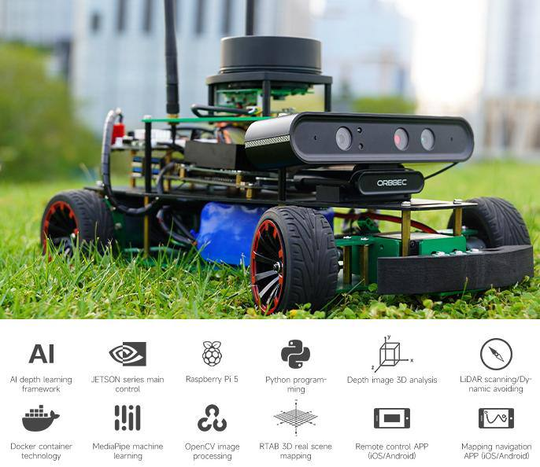
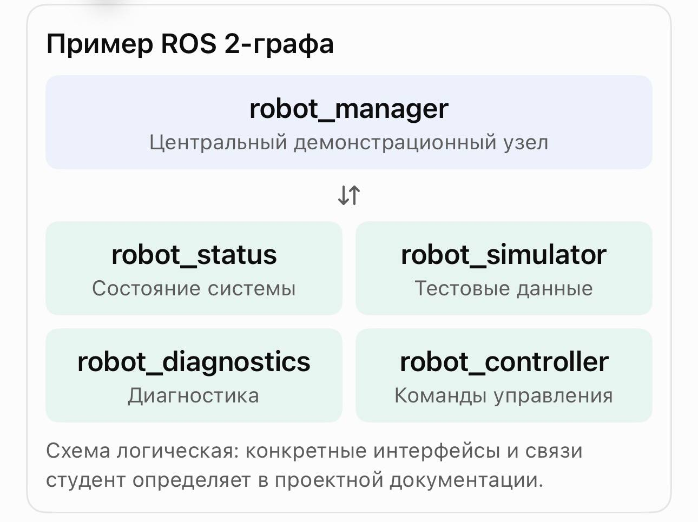
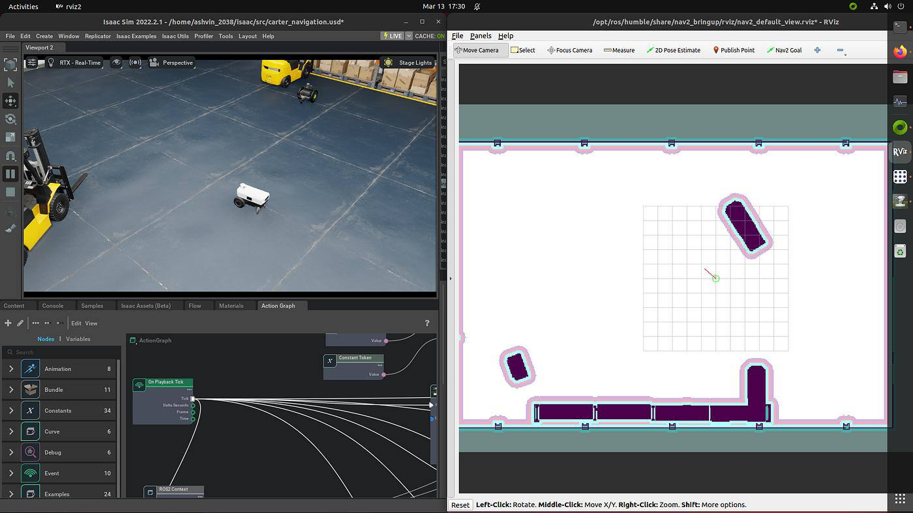
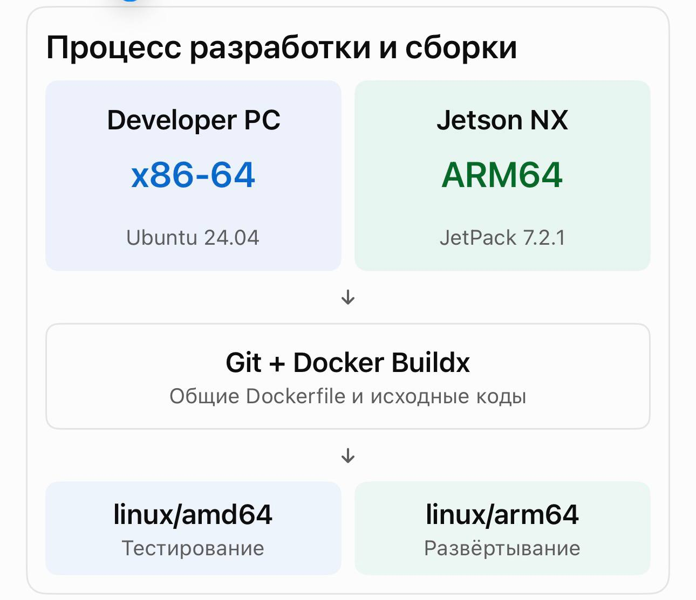
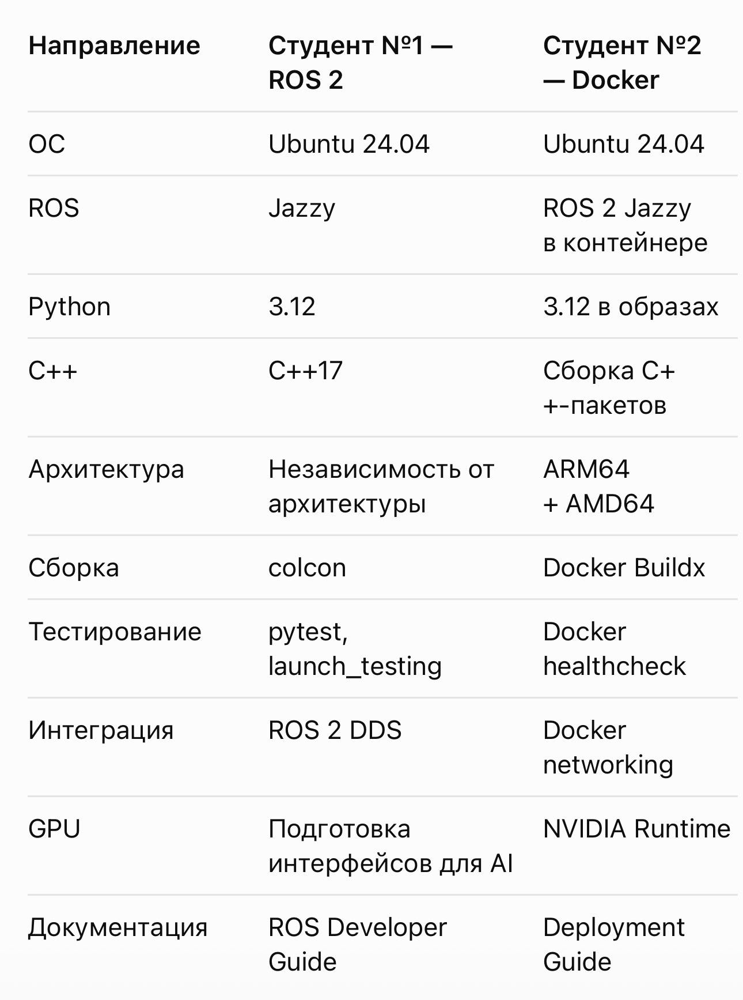

Студент №1 — ROS 2 Developer: разработать программную архитектуру интеллектуального робота, пакеты, интерфейсы и демонстрационные узлы.
Студент №2 — Embedded Linux / DevOps Developer: подготовить Linux-инфраструктуру, Docker-образы, Docker Compose и механизм развёртывания всей программной платформы.

Главный принцип: каждый студент должен передать не просто отчёт об изучении технологий, а работающий программный результат, который впоследствии будет использоваться на настоящем Jetson.

  

1. Общая постановка задачи для практики
Проект: AI Mobile Robot Platform

Цель: разработать базовую программную инфраструктуру интеллектуального мобильного робота на вычислительной платформе NVIDIA Jetson NX 16GB.
Исходные условия:
Аппаратная платформа Jetson NX 16GB.
ОС семейства Ubuntu Linux / NVIDIA JetPack.
Робототехническая middleware ROS 2.
Контейнеризация Docker.
Языки программирования Python и C++.
Возможность дальнейшего подключения камер, LiDAR, IMU и других устройств.
Возможность дальнейшего внедрения алгоритмов искусственного интеллекта.
Ограничение: разработка должна выполняться до получения аппаратного модуля, с последующей возможностью переноса на целевую платформу.

2. Техническое задание №1 — ROS 2 Developer
Название: «Разработка программной архитектуры интеллектуального мобильного робота на базе ROS 2».
Цель: создать ROS 2 workspace с базовыми пакетами, механизмами взаимодействия, тестовыми узлами и средствами диагностики.

Перечень задач:
№ Задача Ожидаемый результат
1 Изучить архитектуру ROS 2, DDS и жизненный цикл узлов
Выбрать и обосновать дистрибутив ROS 2 Документ выбора версии
3 Создать ROS 2 workspace Готовый ros2_ws
4 Разработать пакет общих интерфейсов robot_interfaces
5 Разработать пакет системной диагностики robot_diagnostics
6 Создать пакет управления конфигурацией и запуска robot_bringup
7 Реализовать тестовые ROS 2-ноды на Python Работающие узлы
8 Реализовать минимум одну демонстрационную ноду на C++ Рабочий C++-узел
9 Настроить обмен сообщениями Topics Проверенный обмен
10 Реализовать пример Services и Actions Работающие сервис и действие
11 Разработать систему конфигурации через YAML Конфигурационные файлы
12 Подготовить автоматические тесты Результаты тестирования
13 Подготовить документацию и демонстрацию Руководство разработчика

2.1. Обязательная структура проекта
ros2_ws/
└── src/
    ├── robot_interfaces/
    │   ├── msg/
    │   ├── srv/
    │   └── action/
    │
    ├── robot_core/
    │   ├── robot_status/
    │   └── robot_manager/
    │
    ├── robot_diagnostics/
    │
    ├── robot_bringup/
    │   ├── launch/
    │   └── config/
    │
    └── robot_examples/
        ├── python_nodes/
        └── cpp_nodes/

2.2. Что конкретно должно работать
Студент должен разработать демонстрационную систему из нескольких узлов:

  

Обязательные топики:

Topic Назначение
/robot/status Состояние робота
/robot/telemetry Демонстрационная телеметрия
/robot/diagnostics Диагностические данные
/robot/command Команды управления

Дополнительно:
Сервис /robot/reset.
Сервис /robot/set_mode.
Action /robot/execute_task.
Должны быть продемонстрированы:
публикация и получение сообщений;
передача команд;
обработка некорректных параметров;
запуск и остановка узлов;
восстановление после штатного перезапуска;
проверка состояния системы.

/robot/reset.
Сервис /robot/set_mode.
Action /robot/execute_task.
Должны быть продемонстрированы:
публикация и получение сообщений;
передача команд;
обработка некорректных параметров;
запуск и остановка узлов;
восстановление после штатного перезапуска;
проверка состояния системы.
2.3. Критерии оценки студента №1
Максимум — 100 баллов
Критерий Баллы
Архитектура ROS 2 и обоснование выбора версии 10
Корректная структура workspace и пакетов 10
Разработка собственных сообщений, сервисов и Actions 15
Реализация Python-узлов 10
Реализация C++-узла 10
Работа Topics и DDS-коммуникации 10
Launch-файлы и конфигурация YAML 10
Диагностика и обработка ошибок 10
Автоматические тесты 5
Документация и демонстрация 10
Итого 100

Минимальные условия зачёта:
ROS 2 workspace собирается без ошибок.
Все демонстрационные узлы запускаются.
Сообщения передаются между узлами.
Работают хотя бы один Service и один Action.
Есть инструкция, позволяющая другому разработчику повторить демонстрацию.

3. Техническое задание №2 — Embedded Linux / Docker Developer 
Студент 2

Название: «Разработка контейнеризированной программной инфраструктуры интеллектуального мобильного робота на базе NVIDIA Jetson».
Цель: создать воспроизводимую среду развёртывания, сборки, запуска и обслуживания программного обеспечения робота на NVIDIA Jetson NX 16GB.
Здесь я бы сделал акцент не просто на изучении Docker, а на создании полноценного дистрибутива программной платформы робота.

3.1. Перечень задач

№ Задача Ожидаемый результат
1 Изучить архитектуру Jetson и JetPack Технический обзор
2 Изучить Ubuntu для ARM64 Документация
3 Изучить Docker Engine и Compose Рабочая конфигурация
4 Изучить ARM64-контейнеризацию Тестовая сборка
5 Подготовить базовый Dockerfile Базовый образ
6 Создать ROS 2 Docker-образ Рабочий контейнер
7 Подготовить Docker Compose Комплексный запуск
8 Настроить контейнерную сеть Связь между сервисами
9 Настроить постоянное хранение данных Volumes
10 Настроить переменные окружения Конфигурация
11 Реализовать скрипты управления Build / Start / Stop
12 Настроить мониторинг контейнеров Healthcheck
13 Подготовить механизм автоматического перезапуска Restart Policy
14 Изучить NVIDIA Container Runtime Поддержка GPU
15 Подготовить документацию развёртывания Deployment Guide

3.2. Требуемая структура Docker-проекта

robot-platform/
│
├── docker/
│   ├── base/
│   │   └── Dockerfile
│   │
│   ├── ros2/
│   │   └── Dockerfile
│   │
│   ├── applications/
│   │   ├── Dockerfile
│   │   └── requirements.txt
│   │
│   └── docker-compose.yml
│
├── config/
│   ├── environment.env
│   └── robot.yaml
│
├── scripts/
│   ├── install.sh
│   ├── build.sh
│   ├── start.sh
│   ├── stop.sh
│   ├── restart.sh
│   ├── status.sh
│   ├── logs.sh
│   └── backup.sh
│
├── data/
│
├── logs/
│
└── docs/
    ├── installation.md
    ├── deployment.md
    └── troubleshooting.md

3.3. Предлагаемый состав контейнеров

Контейнер Назначение Приоритет
robot-ros2 Базовая ROS 2-среда Обязательно
robot-core Демонстрационные приложения и узлы Обязательно
robot-api Интерфейс внешнего взаимодействия Дополнительно
robot-dashboard Веб-интерфейс Дополнительно
robot-monitoring Мониторинг системы Дополнительно

Я бы не требовал на первом этапе разворачивать все пять контейнеров. Главное — два обязательных контейнера, совместная работа ROS 2 и возможность дальнейшего добавления сервисов.

3.4. Что студент должен реализовать

А. Автоматическая сборка

./scripts/build.sh

Скрипт должен собирать необходимые Docker-образы.
Б. Запуск системы

./scripts/start.sh

Должны запускаться все обязательные сервисы.
В. Проверка состояния

./scripts/status.sh

Должны отображаться:
список контейнеров;
состояние каждого контейнера;
статус ROS 2;
время работы;
состояние основных сервисов.
Г. Остановка

./scripts/stop.sh

Д. Просмотр журналов

./scripts/logs.sh

S 2 и базовых образов должны быть зафиксированы.
Docker Compose должен обеспечивать воспроизводимый запуск.
Данные должны сохраняться за пределами контейнеров.
Должна быть предусмотрена диагностика ошибок запуска.
Контейнеры должны взаимодействовать с ROS 2 через DDS.
Должна быть предусмотрена возможность доступа к GPU NVIDIA.
Должна быть подготовлена процедура переноса системы на Jetson.

Важное техническое условие: студент может разрабатывать на обычном x86-64 ПК, но должен подготовить ARM64-сборку. QEMU или Buildx подходят для предварительной проверки архитектуры образов, однако не подтверждают работу NVIDIA GPU, драйверов, GPIO и реального оборудования. Это будет отдельным этапом аппаратной приёмки.

3.6. Критерии оценки студента №2
Максимум — 100 баллов

Критерий Баллы
Анализ Jetson, Ubuntu, JetPack и ARM64 10
Корректность базовых Docker-образов 10
Разработка ROS 2 Docker-образа 15
Docker Compose и конфигурация сервисов 15
Сетевая коммуникация между контейнерами 10
Постоянное хранение данных 5
Скрипты автоматизации развёртывания 10
Диагностика, мониторинг и восстановление 10
Подготовка ARM64-сборки 5
Документация и демонстрация 10
Итого 100

Минимальные условия зачёта:
Docker-образы успешно собираются.
Docker Compose запускает систему.
ROS 2 работает внутри контейнера.
Контейнеры обмениваются сообщениями.
Данные сохраняются после перезапуска.
Есть инструкция развёртывания на целевой платформе.

4. Общее интеграционное задание для двух студентов
Это принципиально важная часть. Я бы не принимал две работы отдельно, пока они не продемонстрировали совместимость.
Название: «Развёртывание и запуск базовой программной платформы интеллектуального мобильного робота».
Студенты совместно должны:
Объединить ROS 2 workspace с Docker-инфраструктурой.
Собрать ROS 2-пакеты внутри Docker.
Запустить несколько ROS 2-узлов в контейнерах.
Организовать обмен данными между узлами.
Продемонстрировать передачу тестовой телеметрии.
Проверить перезапуск контейнеров.
Продемонстрировать восстановление после остановки одного из сервисов.
Подготовить единую инструкцию запуска.

  

Сценарий итоговой демонстрации
Приёмочный тест
Разработчик запускает сборку Docker-образов.
Запускает программную платформу одной командой.
ROS 2 запускает тестовые узлы.
Один узел публикует тестовую телеметрию.
Другой узел принимает и обрабатывает сообщения.
Проверяется состояние ROS 2 и Docker.
Останавливается один контейнер, затем проверяется восстановление.
После перезапуска проверяется сохранность данных и конфигурации.
Результат- воспроизводимая работающая система

5. Требования к описанию результатов работы
Здесь я рекомендую поставить отдельное обязательное требование: каждый студент должен подготовить не формальный отчёт о практике, а полноценную инженерную документацию, которая останется в проекте и будет использоваться следующими разработчиками.
Каждый студент сдаёт четыре результата:

Документ / результат Студент №1 Студент №2
Технический обзор ROS 2, DDS Jetson, Linux, Docker
Архитектурное описание ROS 2-граф, пакеты Контейнеры, сети, volumes
Руководство разработчика Сборка и запуск ROS 2 Сборка и запуск Docker
Отчёт об испытаниях Тесты узлов и интерфейсов Тесты образов и контейнеров

Обязательная структура технического отчёта
Цель и задачи работы.
Анализ существующих решений.
Обоснование выбора технологий и версий.
Архитектура разработанного решения.
Структура программного проекта.
Описание реализованных модулей.
Инструкция по установке и настройке.
Инструкция по запуску и демонстрации.
Результаты испытаний.
Выявленные ограничения и проблемы.
Рекомендации по дальнейшему развитию.
Обязательно приложить:
схемы архитектуры;
скриншоты успешных запусков;
листинги основных конфигураций;
результаты тестирования;
ссылки на Git-коммиты;
перечень известных ограничений.
Важный момент: отчёт должен позволять другому программисту развернуть и запустить разработанную систему без личных консультаций с автором.

6. План практики на 3 недели
Период ROS 2 Developer Docker Developer
Дни 1–3 Анализ ROS 2, выбор версии, архитектура Анализ Jetson, JetPack, ARM64
Дни 4–6 Workspace, базовые пакеты Docker Engine, базовые образы
Дни 7–9 Узлы Python и C++, интерфейсы ROS 2 Dockerfile
Дни 10–12 Topics, Services, Actions Docker Compose, сети
Дни 13–15 Launch, диагностика, тесты Скрипты, volumes, мониторинг
Дни 16–18 Совместная интеграция Совместная интеграция
Дни 19–21 Испытания, документация, защита Испытания, документация, защита

7. Организация Git-репозитория
Я бы создал один общий репозиторий, чтобы все результаты не оказались на личных компьютерах студентов.
AI-Mobile-Robot-Platform

AI-Mobile-Robot-Platform/
│
├── ros2_ws/
│   └── src/
│       ├── robot_interfaces/
│       ├── robot_core/
│       ├── robot_diagnostics/
│       ├── robot_bringup/
│       └── robot_examples/
│
├── docker/
│   ├── base/
│   ├── ros2/
│   ├── applications/
│   └── docker-compose.yml
│
├── scripts/
│
├── config/
│
├── tests/
│   ├── ros2/
│   ├── docker/
│   └── integration/
│
├── docs/
│   ├── architecture/
│   ├── installation/
│   ├── development/
│   ├── testing/
│   └── reports/
│
└── README.md

Ветки:
main — проверенная интеграционная версия.
feature/ros2-platform — студент №1.
feature/docker-platform — студент №2.
Интеграция через Pull Request.

Итоговые артефакты проекта
Готовый ROS 2 workspace
Комплект Dockerfile и Docker Compose
ARM64-совместимые образы
Скрипты установки, сборки и запуска
Демонстрационная ROS 2-система
Автоматические тесты
Полная техническая документация
Инструкция переноса на NVIDIA Jetson

Моя рекомендация — ориентироваться на NVIDIA Jetson Orin NX 16GB, JetPack 7.2.1, Ubuntu 24.04 и ROS 2 Jazzy.
Это современная платформа, позволяющая использовать актуальную экосистему ROS 2 и NVIDIA для Edge AI. JetPack 7.2.1 поддерживает семейство Orin, включая Orin NX, и поставляется с Ubuntu 24.04, CUDA 13.2.2 и TensorRT 10.16.2.

1. Зафиксированный технологический стек
AI Mobile Robot Platform — Technology Baseline
Вычислительная платформа
NVIDIA Jetson Orin NX 16GB
ARM64 / NVIDIA Ampere GPU
Операционная система
Ubuntu 24.04 LTS
NVIDIA Jetson Linux / JetPack 7.2.1
Робототехническая платформа
ROS 2 Jazzy Jalisco
Python / C++ / DDS / RMW
Контейнеризация
Docker Engine + Docker Compose v2
NVIDIA Container Toolkit / Runtime

AI / GPU
CUDA 13.2.2 / TensorRT 10.16.2
Среда NVIDIA JetPack 7.2.1
Инструменты разработки
Python 3.12
C++17
CMake 3.x
Git
VS Code
colcon
pytest / launch_testing
GitHub Actions
Здесь есть важная оговорка: эта конфигурация рассчитана именно на Orin NX, а не на старый Xavier NX. Если на заказе указано другое обозначение, аппаратную совместимость необходимо сверить до прошивки.

2. Конкретные рекомендации по ROS 2
Использовать:
ROS 2 Jazzy Jalisco.
Ubuntu 24.04.
Python 3.12.
C++17.
Middleware: rmw_fastrtps_cpp (Fast DDS).
Сборка: colcon.
Система сборки пакетов: ament_cmake, ament_python.
Причина выбора: ROS 2 Jazzy рассчитан на Ubuntu 24.04, включая архитектуру ARM64. Это позволяет разрабатывать на обычном компьютере и затем переносить пакеты на Jetson без смены дистрибутива ROS.

Обязательные ROS 2-пакеты:
Пакет Назначение
robot_interfaces Собственные сообщения, сервисы, Actions
robot_core Базовые системные узлы
robot_bringup Запуск всей системы
robot_diagnostics Диагностика
robot_description URDF/Xacro модели
robot_examples Демонстрационные узлы

Дополнительно подготовить совместимость с tf2, diagnostic_msgs, sensor_msgs, geometry_msgs, nav_msgs.
Навигационные пакеты пока не нужно полноценно реализовывать. Достаточно предусмотреть возможность их дальнейшего подключения.

3. Конкретные рекомендации по Docker
Студент №2 должен подготовить контейнерную инфраструктуру со следующими параметрами:

Компонент Рекомендация
Container Engine Docker Engine
Оркестрация Docker Compose V2
Runtime NVIDIA NVIDIA Container Runtime
Базовый ROS-образ ros:jazzy-ros-base-noble
Архитектура целевой системы linux/arm64
Архитектура разработки linux/amd64
Сборка Docker Buildx
Хранение данных Docker Volumes
Сеть ROS 2 Host networking на Jetson
Автозапуск Docker restart policy + systemd

Базовые образы
Использовать:

FROM ros:jazzy-ros-base-noble

Это базовый образ для ROS 2 без графических инструментов.
Для разработки и тестирования на обычном ПК он подходит. Для GPU-зависимых приложений на Jetson необходимо дополнительно использовать совместимые с JetPack 7.2.1 библиотеки NVIDIA и соответствующий NVIDIA runtime.
Не нужно устанавливать CUDA Toolkit вручную внутрь каждого контейнера или заменять системные драйверы Jetson контейнерными. Драйверная часть должна соответствовать JetPack на хосте.

Обязательные настройки
Использовать NVIDIA Container Toolkit.
Проверить GPU-доступ из контейнера.
Настроить доступ к USB и последовательным портам.
Организовать постоянное хранение конфигураций и данных.
Использовать фиксированные версии образов и зависимостей.
Настроить network_mode: host для первоначальной интеграции ROS 2.
Предусмотреть отдельный профиль для тестирования без GPU.
NVIDIA документирует настройку Docker и NVIDIA Container Runtime для Jetson.

4. Архитектура сборки: x86-64 и ARM64
Здесь я рекомендую принять одно конкретное решение:
Один исходный код — две архитектуры сборки — один целевой формат развёртывания ARM64.

  

Студент №2 должен реализовать:

docker buildx build \
  --platform linux/amd64,linux/arm64 \
  -t ai-robot/ros2-platform:1.0 \
  .

Для первой версии это требование относится к ROS 2 и общим прикладным образам. GPU-зависимые образы NVIDIA должны собираться и проверяться отдельно под ARM64.
QEMU можно использовать для предварительной сборки ARM64 на x86-64, но нельзя считать такую проверку подтверждением работоспособности Jetson.

5. Какую конфигурацию я рекомендую зафиксировать в ТЗ
Предлагаю следующий единый файл platform-versions.yaml:

platform:
  hardware: NVIDIA Jetson Orin NX 16GB
  architecture: aarch64

os:
  distribution: Ubuntu
  version: "24.04"
  jetpack: "7.2.1"
  jetson_linux: "39.2.1"

robotics:
  framework: ROS2
  distribution: jazzy
  middleware: rmw_fastrtps_cpp

development:
  python: "3.12"
  cpp_standard: "17"
  build_system: colcon
  cmake: "3.x"

containers:
  engine: Docker
  compose: "v2"
  runtime: nvidia
  build_system: buildx

ai:
  cuda: "13.2.2"
  tensorrt: "10.16.2"

architectures:
  development: linux/amd64
  deployment: linux/arm64

Это исходная спецификация, а не утверждение, что каждый компонент уже проверен на конкретной плате. После первого развёртывания студент №2 должен дополнить её точными версиями Docker Engine, Compose, Container Toolkit и контрольными SHA256 образов.

Направление Студент №1 — ROS 2 Студент №2 — Docker
ОС Ubuntu 24.04 Ubuntu 24.04
ROS Jazzy ROS 2 Jazzy в контейнере
Python 3.12 3.12 в образах
C++ C++17 Сборка C++-пакетов
Архитектура Независимость от архитектуры ARM64 + AMD64
Сборка colcon Docker Buildx
Тестирование pytest, launch_testing Docker healthcheck
Интеграция ROS 2 DDS Docker networking
GPU Подготовка интерфейсов для AI NVIDIA Runtime
Документация ROS Developer Guide Deployment Guide

  

!!!

Целевая платформа: NVIDIA Jetson Orin NX 16GB
JetPack 7.2.1
Ubuntu 24.04 LTS
ROS 2 Jazzy
Docker Engine + Docker Compose V2
NVIDIA Container Runtime
Python 3.12
C++17
CUDA 13.2.2
TensorRT 10.16.2
ARM64 — целевая архитектура
AMD64 — архитектура предварительной разработки
